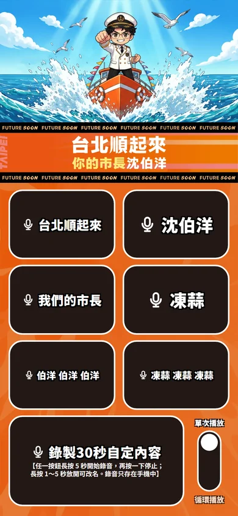

# 洋流應援大聲公

開源、免費的應援音效板 App。錄下自己的應援口號，手機連上藍牙喇叭，按下按鈕就能大聲播放。

**官方網址（唯一的官方版本）：https://yangliu-tw.github.io/yangliu-megaphone/**

其他網址上的版本都是他人修改的版本，與本專案無關。



> **非官方聲明**：本 App 是支持者自發製作的應援工具，不是候選人或競選團隊的官方產品，也未接受其委託或贊助。

## 功能

- **7 顆錄音按鈕**：6 顆短口號按鈕（每顆最長 5 秒）＋ 1 顆長錄音鍵（最長 30 秒）
- **自訂名稱**：錄完自動跳出命名視窗，之後也可以隨時改名
- **單次／循環播放**：循環模式每輪間隔 0.5 秒，適合喊口號
- **離線可用**：安裝到主畫面後，沒有網路也能開啟與播放
- **沒有廣告、沒有追蹤、不用註冊**

## 使用方式

| 操作 | 結果 |
| --- | --- |
| 長按任一按鈕 **5 秒** | 開始錄音，手指可以放開；再按一下停止 |
| 錄音結束 | 自動跳出命名視窗，名稱最多 8 個字 |
| 長按 **1～5 秒**後放開 | 只改名稱，不重新錄音 |
| 單按有錄音的按鈕 | 播放；播放中按另一顆會切換成新的聲音 |
| 右下角開關 | 切換「單次播放」或「循環播放」；循環中再按同一顆就停止 |

使用藍牙喇叭時，先在手機的藍牙設定連好喇叭，App 的聲音就會從喇叭播出。

## 安裝到主畫面

**請先安裝，再錄音。** iPhone 在 Safari 裡錄的音，不會帶到主畫面的 App。

### iPhone（Safari）

1. 用 **Safari** 開啟官方網址
2. 點下方工具列的「分享」按鈕
3. 選「加入主畫面」，再點右上角「新增」
4. 之後從主畫面的「洋流應援大聲公」開啟

### Android（Chrome）

1. 用 **Chrome** 開啟官方網址
2. 點畫面上的「安裝」，或從右上角選單選「安裝應用程式」／「加到主畫面」
3. 之後從主畫面的「洋流應援大聲公」開啟

從 LINE、Facebook、Instagram 點開連結時，請改用 Safari 或 Chrome 開啟。這些 App 內建的瀏覽器無法安裝，也可能無法錄音。

## 隱私

- 錄音與按鈕名稱**只存在你的手機裡**，不會上傳到任何地方。
- 沒有後端伺服器、沒有帳號、沒有廣告、沒有使用者追蹤。
- 刪除 App，或清除瀏覽器的網站資料，錄音就會一起刪除。

## 已知限制

- **藍牙延遲**：藍牙喇叭本身約有 0.1～0.3 秒延遲，App 無法消除。
- **錄音時建議先中斷藍牙**：連著藍牙喇叭時，手機可能改用喇叭的麥克風錄音，音質會變差。錄完再連回喇叭即可。
- **來電與通話**：播放中遇到來電或 LINE 通話會自動停止，通話結束後不會自動續播。部分 Android 手機在來電時不會中斷網頁的聲音，建議通話前先暫停播放。
- **只有前景才播放**：切到其他 App 或鎖定螢幕時，聲音會停止。
- **iPhone 靜音開關**：較新的 iOS 在靜音模式下仍會出聲；如果沒有聲音，請關閉靜音模式再試。
- **資料保存**：iPhone 長時間沒有開啟網頁版時，系統可能清除網站資料。安裝到主畫面可以降低這個風險。

## 改成自己的版本

歡迎 fork 本專案，做成你自己的應援工具：

1. Fork 這個 repo，並在 repo 設定開啟 GitHub Pages（從 `main` 分支根目錄發布）。
2. 修改 `buttons.json` 的按鈕預設名稱與錄音秒數。
3. 替換 `assets/images/` 與 `assets/icons/` 的圖片，改成你自己的素材。
4. 修改 `manifest.webmanifest` 與 `index.html` 裡的 App 名稱。
5. 修改 `js/install.js` 裡的 `OFFICIAL_URL`，改成你自己的網址。
6. **每次更新內容後**，把 `sw.js` 開頭的 `CACHE_VERSION` 改成新的值（任何不重複的字串都可以），已安裝的使用者才會收到「有新版本」的提示。

本 repo 是部署用的網頁檔案。在電腦上用任何靜態伺服器就能執行，例如：

```sh
python -m http.server 8000
```

然後開啟 `http://localhost:8000/`。麥克風與離線功能需要 HTTPS 或 `localhost`，用區網 IP 連線時無法錄音。

## 授權

- **程式碼**：[MIT License](LICENSE)，Copyright (c) 2026 洋流應援大聲公 contributors。
- **畫面圖片**（`assets/images/`、`assets/icons/`、`assets/readme/` 內的角色、船景、橫幅、圖示與截圖）：[CC BY 4.0](https://creativecommons.org/licenses/by/4.0/deed.zh-hant)，使用時請標示「洋流應援大聲公 contributors」並附上本 repo 連結。
- 圖片授權只涵蓋著作權，不包含圖中人物的肖像權；使用時請自行留意相關權利。
